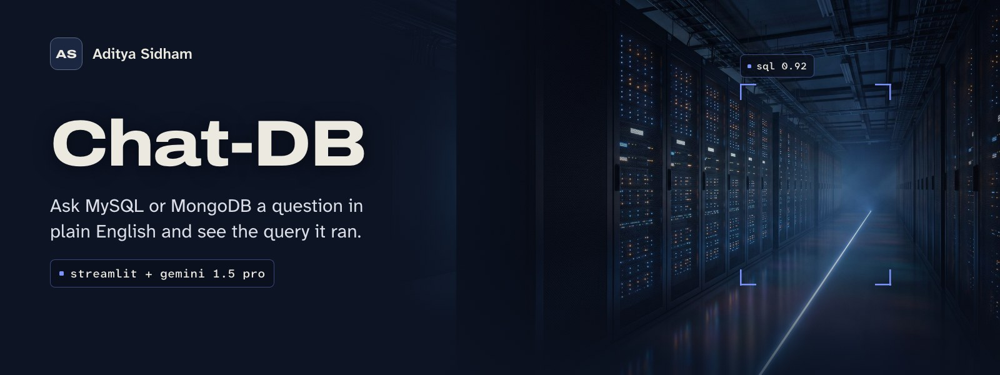
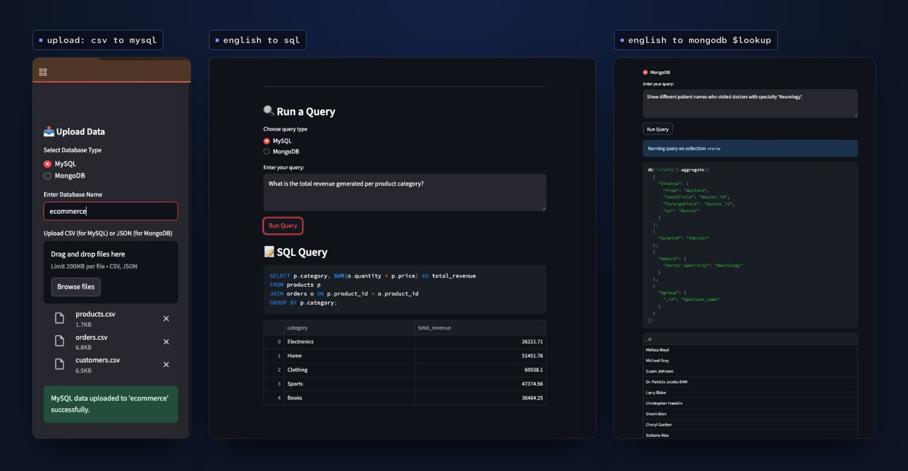
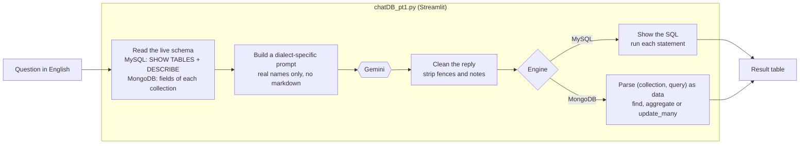

<a id="readme-top"></a>

<div align="center">

<a href="https://adityasidham.site/ChatDB.html"></a>

<br>


**[Case study](https://adityasidham.site/ChatDB.html)** &nbsp;|&nbsp; **[See it](#see-it)** &nbsp;|&nbsp; **[How it works](#how-it-works)** &nbsp;|&nbsp; **[Try these](#questions-to-try)** &nbsp;|&nbsp; **[Run it](#getting-started)**

</div>

<br>

You can understand the business question and still get stuck on joins, field names or MongoDB's aggregation syntax. **Chat-DB removes that first barrier.** Load a database, ask in plain English, and it writes the SQL or MongoDB query against your real schema, shows it to you, runs it and puts the result in a table.

It's a graduate project from USC (spring 2025). I led the four-person team, shaped the architecture and ran the delivery plan.

| **~60%** | **92%** | **150** | **12** |
|:---:|:---:|:---:|:---:|
| less time writing queries for non-SQL users | result correctness | labeled test questions | regressions caught before release |

<sub>Numbers are from the team's evaluation during the project. That test suite isn't part of this repository.</sub>

## See it

<p align="center">
  
</p>

## How it works



- **Schema grounding.** Before every question, the app reads the tables and columns (or collections and fields) of the database you named, and puts them in the prompt. Gemini writes against real names instead of guessing.
- **Two prompt paths.** SQL and MongoDB get separate instructions. MongoDB answers come back as a small Python structure: `(collection, filter)` for reads, `(collection, pipeline)` for aggregations, `(collection, (filter, update))` for updates.
- **Parsed, never executed.** The MongoDB structure is read with `ast.literal_eval`, so model output is treated as data and can't run code.
- **You see what ran.** The generated SQL or MongoDB call is shown above the results.
- **Bring your own data.** Upload CSV files to create MySQL tables or JSON/NDJSON files to create MongoDB collections, straight from the sidebar.

## Questions to try

Upload one of the sample datasets, type its name in the sidebar, then ask:

| Database | Engine | Question |
|---|---|---|
| `chatdb` | MySQL | What is the total revenue generated per product category? |
| `chatdb` | MySQL | List customer names along with the product names they ordered in 2025. |
| `clinic` | MongoDB | List all doctors with more than 20 years of experience. Show only names and years of experience. |
| `clinic` | MongoDB | Show different patient names who visited doctors with specialty 'Neurology'. |
| `clinic` | MongoDB | Update the specialty of the doctor named 'Kyle Bowman' to 'Neurology'. |

<details>
<summary><b>Sample data included</b></summary>

<br>

| Folder | Database | Tables or collections |
|---|---|---|
| `SQL Databases/` | `chatdb` | customers, orders, products |
| | `educationdb` | students, grades |
| | `healthdb` | patients, appointments |
| `MongoDB databases/` | `ecommerce` | users, transactions |
| | `university` | professors, courses |
| | `clinic` | doctors, visits |

</details>

<p align="right"><a href="#readme-top">Back to top</a></p>

## Getting started

**You'll need** Python 3.9 or later, a local [MySQL](https://dev.mysql.com/downloads/mysql/) server, [MongoDB Community](https://www.mongodb.com/try/download/community), and a Gemini API key from [Google AI Studio](https://aistudio.google.com/app/apikey).

```bash
git clone https://github.com/AdityaSidham/Chat-DB.git
cd Chat-DB
python3 -m venv .venv && source .venv/bin/activate
pip install -r requirements.txt
```

Settings come from environment variables, so no key or password lives in the code. Copy the example file, fill it in, and load it into your shell:

```bash
cp .env.example .env
set -a; source .env; set +a
```

| Variable | Default | Notes |
|---|---|---|
| `GEMINI_API_KEY` | none | Required |
| `GEMINI_MODEL` | `gemini-3.8-flash` | The project first ran on Gemini 1.5 Pro, which Google has since retired. Use any current model. |
| `MYSQL_HOST`, `MYSQL_USER`, `MYSQL_PASSWORD` | `localhost`, `root`, `password` | |
| `MONGO_URI` | `mongodb://127.0.0.1:27017` | |

Then start the app:

```bash
streamlit run chatDB_pt1.py
```

1. In the sidebar, pick **MySQL** or **MongoDB**, type a database name and upload the matching files from `SQL Databases/` or `MongoDB databases/`.
2. Choose the same engine under **Run a Query**, ask a question and press **Run Query**. Queries run against the database named in the sidebar.

> [!WARNING]
> Chat-DB runs what the model writes, including `INSERT`, `UPDATE`, `DELETE` and MongoDB `update_many`. Point it at a scratch database. Uploading to MongoDB drops that database first, and uploading a CSV replaces any MySQL table with the same name.

## Project structure

```text
Chat-DB/
├── chatDB_pt1.py          the Streamlit app: upload, schema discovery, prompting, execution
├── requirements.txt
├── .env.example           settings to export before running
├── SQL Databases/         CSV files for three sample MySQL databases
└── MongoDB databases/     JSON files for three sample MongoDB databases
```

<p align="right"><a href="#readme-top">Back to top</a></p>

## Author

**Aditya Sidham**, applied AI, iOS and backend engineer in Los Angeles. I led the four-person team that built Chat-DB at USC.

[](https://adityasidham.site)
[](https://www.linkedin.com/in/adityasidham/)
[](https://github.com/AdityaSidham)

Questions or ideas? [Open an issue](https://github.com/AdityaSidham/Chat-DB/issues).
